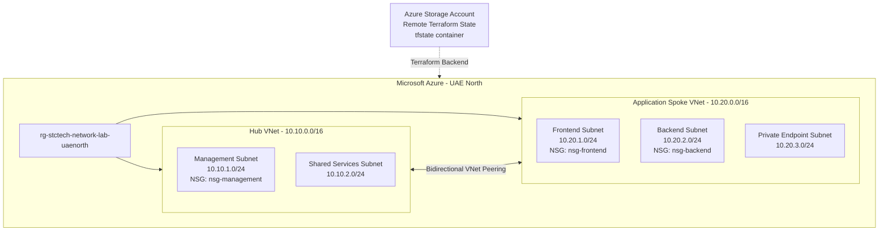

# Azure Terraform Network Capstone

A hands-on Azure networking project built with Terraform to demonstrate Infrastructure as Code (IaC), Hub-Spoke network architecture, network segmentation, secure remote Terraform state, and Azure networking fundamentals.

The project is designed as a cost-conscious lab environment while following practical Azure infrastructure and Terraform patterns.

---

## Project Objectives

This project demonstrates how to:

- Deploy Azure networking infrastructure using Terraform
- Implement a Hub-Spoke network topology
- Create segmented subnets for different workload tiers
- Configure bidirectional VNet Peering
- Apply subnet-level Network Security Groups
- Implement explicit network security rules
- Use Terraform dependency references
- Store Terraform state remotely in Azure Storage
- Authenticate Terraform to Azure using Microsoft Entra ID / Azure CLI
- Validate deployed infrastructure using Terraform and Azure CLI
- Maintain a cost-conscious Azure lab environment

---

## Architecture



---

## Network Addressing

| Network | CIDR | Purpose |
|---|---|---|
| Hub VNet | `10.10.0.0/16` | Central/shared network |
| Management Subnet | `10.10.1.0/24` | Administrative workloads |
| Shared Services Subnet | `10.10.2.0/24` | Future shared services |
| Application Spoke VNet | `10.20.0.0/16` | Application workloads |
| Frontend Subnet | `10.20.1.0/24` | Frontend tier |
| Backend Subnet | `10.20.2.0/24` | Backend tier |
| Private Endpoint Subnet | `10.20.3.0/24` | Private endpoint workloads |

The Hub and Spoke address spaces do not overlap, allowing private connectivity through VNet Peering.

---

## Hub-Spoke Design

The environment uses two virtual networks:

### Hub VNet

`vnet-stctech-hub`

Address space:

`10.10.0.0/16`

Contains:

- Management subnet
- Shared Services subnet

### Application Spoke VNet

`vnet-stctech-spoke-app`

Address space:

`10.20.0.0/16`

Contains:

- Frontend subnet
- Backend subnet
- Private Endpoint subnet

Bidirectional VNet Peering connects the Hub and Spoke through the Azure backbone.

The peering configuration currently allows virtual network access while gateway transit and forwarded traffic remain disabled because no VPN Gateway, Azure Firewall, or Network Virtual Appliance is deployed in this lab.

---

## Network Security Design

Network Security Groups are associated at the subnet level.

This provides a consistent security policy for workloads deployed into each application tier.

### Backend Security Policy

| Priority | Source | Destination Port | Protocol | Action |
|---:|---|---:|---|---|
| 100 | `10.20.1.0/24` Frontend | 8080 | TCP | Allow |
| 110 | `10.10.1.0/24` Management | 22 | TCP | Allow |
| 4000 | VirtualNetwork | Any | Any | Deny |

The explicit `Deny-VNet-Inbound` rule is evaluated before Azure's default `AllowVNetInBound` rule.

This prevents unintended east-west traffic while allowing explicitly defined application and management flows.

### Frontend Security Policy

The Frontend NSG permits HTTP traffic on TCP port 80 and explicitly restricts other Virtual Network inbound traffic according to the lab security design.

> Creating an NSG alone does not enforce a policy. The NSG must be associated with a subnet or network interface. This project uses subnet-level NSG associations.

---

## Stateful NSG Behavior

Azure Network Security Groups are stateful.

For example, when this connection is permitted:

`Frontend → Backend : TCP/8080`

response traffic associated with the established connection is automatically permitted.

A separate reverse NSG rule is therefore not required solely for return traffic.

---

## Terraform Remote State

Terraform state is not stored in the Git repository.

A dedicated Azure Storage backend is used instead.

Bootstrap infrastructure includes:

- Dedicated Resource Group
- Azure Storage Account
- Private Blob Container
- Storage Blob Data Contributor RBAC assignment
- Microsoft Entra ID authentication

Two separate state objects are used:

```text
tfstate/
├── bootstrap.tfstate
└── network-capstone.tfstate
```

This separates the Terraform backend infrastructure from the network lab infrastructure.

Terraform state files, variable files, plan files, and other sensitive/local Terraform artifacts are excluded from Git through `.gitignore`.

---

## Repository Structure

```text
Azure-Terraform-Network-Capstone/
│
├── bootstrap/
│   ├── backend.tf
│   ├── main.tf
│   ├── outputs.tf
│   ├── variables.tf
│   └── .terraform.lock.hcl
│
├── environments/
│   └── lab/
│       ├── backend.tf
│       ├── main.tf
│       ├── nsg.tf
│       ├── peering.tf
│       ├── providers.tf
│       ├── variables.tf
│       └── .terraform.lock.hcl
│
├── .gitignore
└── README.md
```

Terraform reads all `.tf` files within the same directory as one configuration.

The files are separated by infrastructure responsibility to improve readability and maintainability.

---

## Terraform Dependency Model

Resources use Terraform references rather than unnecessary explicit `depends_on` declarations.

Example:

```hcl
subnet_id = azurerm_subnet.spoke_backend.id
```

Terraform can infer that the subnet must exist before the dependent resource can be created.

The resulting dependency flow includes:

```text
Resource Group
      |
      +--> Virtual Networks
              |
              +--> Subnets
              |
              +--> VNet Peering

NSGs
  |
  +--> Security Rules
  |
  +--> Subnet Associations
```

---

## Deployment Workflow

From the lab environment:

```powershell
cd environments\lab

terraform init
terraform fmt
terraform validate
terraform plan
terraform apply
```

Before applying infrastructure changes, the Terraform execution plan should always be reviewed for unexpected modifications or resource destruction.

---

## Validation

The deployed environment was validated at both the Terraform and Azure control-plane levels.

### Terraform

```powershell
terraform validate
terraform plan
terraform state list
```

Final Terraform plan:

```text
No changes. Your infrastructure matches the configuration.
```

The network environment contains 21 Terraform-managed resources.

### VNet Peering

Both directions of the Hub-Spoke peering were verified as:

```text
Connected
```

### NSG Associations

Azure CLI validation confirmed that:

- `nsg-management` is associated with the Management subnet
- `nsg-frontend` is associated with the Frontend subnet
- `nsg-backend` is associated with the Backend subnet

NSG rules were also verified directly from Azure.

---

## Routing

The current architecture relies on Azure system routes.

Azure automatically provides routes for:

- Communication inside a VNet
- Peered virtual networks
- Default routing where applicable

No permanent User Defined Route (UDR) is deployed because the current architecture does not contain an Azure Firewall or Network Virtual Appliance requiring custom next-hop routing.

This avoids introducing artificial routing configuration without an architectural requirement.

A future troubleshooting lab can intentionally introduce an incorrect UDR to demonstrate:

- Effective Routes
- Next Hop analysis
- Routing failure diagnosis
- Terraform-based remediation

---

## Cost-Aware Design

Cost control was an explicit project requirement.

The environment intentionally avoids continuously running expensive services such as:

- Azure Firewall
- VPN Gateway
- Azure Bastion
- Application Gateway
- AKS
- Permanent virtual machines

Temporary test NICs were created during development and subsequently removed through Terraform.

Compute workloads requiring the available higher-cost VM SKUs were intentionally not kept running.

---

## Validation Scope and Limitations

This project validates the Terraform configuration and Azure networking control plane.

Hub-Spoke topology, subnet creation, VNet Peering, NSG rules, and NSG associations were deployed and verified.

Full workload-level data-plane testing using multiple virtual machines was intentionally deferred because the available VM SKUs would introduce unnecessary lab cost.

Therefore, this repository does **not** claim that VM-to-VM flows such as the following were executed:

- Frontend → Backend TCP/8080
- Frontend → Backend TCP/22 denial
- Management → Backend TCP/22

These flows are part of a future temporary workload and network troubleshooting exercise.

This distinction keeps the documented validation evidence aligned with what was actually tested.

---

## Future Work

Future hands-on exercises may extend the environment temporarily with:

- Data-plane connectivity testing
- Effective Security Rules
- Effective Routes
- Network Watcher
- IP Flow Verify
- Next Hop
- Connection Troubleshoot
- Intentional NSG and routing failure scenarios

Azure Monitor, Log Analytics, KQL, alerting, and broader observability are intentionally excluded from this repository and will be implemented as a separate Monitoring & Observability capstone.

---

## Key Skills Demonstrated

- Microsoft Azure Networking
- Terraform
- Infrastructure as Code
- Hub-Spoke Architecture
- Azure Virtual Networks
- Subnet Design
- VNet Peering
- Network Security Groups
- Network Segmentation
- Azure RBAC
- Terraform Remote State
- Azure CLI
- Microsoft Entra ID Authentication
- Infrastructure Validation
- Cost-Aware Cloud Architecture

---

## Author

**Sohrab Jalali**

IT & Network Support | Azure Administrator | Cloud Infrastructure | Terraform